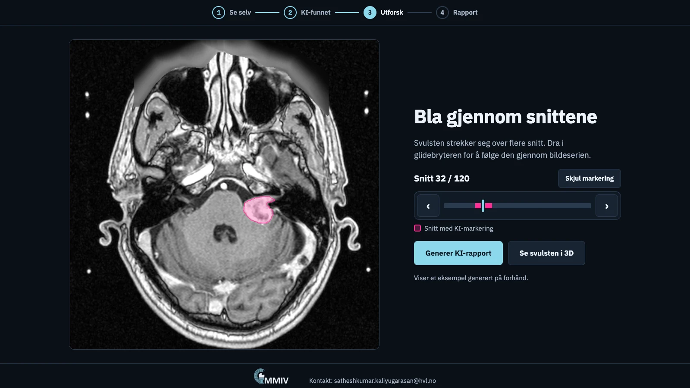

# Vestibular schwannoma demo

An interactive demo built for Forskningsdagene to show visitors how AI can support
the reading of medical images.

Live: <https://medical-ai-demo.pages.dev/>

It walks through one real MRI case in four steps:

1. Look at an MRI slice and see if anything stands out.
2. Reveal the tumour area the AI model has marked.
3. Scroll through the slices and open the tumour as a rotatable 3D model, with its
   calculated volume.
4. Read an AI-generated draft report describing the finding.

The text is in Norwegian, and everything shown is prepared in advance.

Imaging data comes from The Cancer Imaging Archive's
[Vestibular-Schwannoma-SEG](https://www.cancerimagingarchive.net/collection/vestibular-schwannoma-seg/)
collection. See [prep/README.md](prep/README.md) for how the assets are derived.

To run it locally, serve `app/` with any static web server:
`python3 -m http.server --directory app`, then open <http://localhost:8000>.

## Make your own

The app is plain HTML, CSS and JavaScript with no build step. To show your own case:

1. Run `python3 prep/prepare_assets.py --image your_t1.nii.gz --mask your_mask.nii.gz`
   (setup in [prep/README.md](prep/README.md)). It regenerates the slices, the
   overlays, the 3D models and `app/case.json`, which holds the measured volume.
2. Rewrite the text in `app/index.html`: the prompts, the two report versions and
   the patient explainer. Write `{volume}` where the measured volume belongs.
3. Replace or remove the narration in `app/assets/audio/`, and the logo and
   contact line in the footer.

Colours and layout are in `app/styles.css`; `app/app.js` holds only behaviour.
`tools/demo_flow.cjs` tests the whole flow in a browser and checks this demo's
text, so update it along with yours.

## Data licence

The MRI data and tumour segmentation come from the Vestibular-Schwannoma-SEG
collection, which is published under the
[Creative Commons Attribution 4.0 International licence (CC BY 4.0)](https://creativecommons.org/licenses/by/4.0/).
Use of the data is also subject to the
[TCIA Data Usage Policy](https://www.cancerimagingarchive.net/data-usage-policies-and-restrictions/).

Data citation:

> Shapey, J., Kujawa, A., Dorent, R., Wang, G., Bisdas, S., Dimitriadis, A.,
> Grishchuck, D., Paddick, I., Kitchen, N., Bradford, R., Saeed, S., Ourselin, S.,
> & Vercauteren, T. (2021). *Segmentation of Vestibular Schwannoma from Magnetic
> Resonance Imaging: An Open Annotated Dataset and Baseline Algorithm* (version 2)
> [Data set]. The Cancer Imaging Archive.
> <https://doi.org/10.7937/TCIA.9YTJ-5Q73>

Publication citation:

> Shapey, J., Kujawa, A., Dorent, R., Wang, G., Dimitriadis, A., Grishchuk, D.,
> Paddick, I., Kitchen, N., Bradford, R., Saeed, S. R., Bisdas, S., Ourselin, S.,
> & Vercauteren, T. (2021). Segmentation of vestibular schwannoma from MRI, an open
> annotated dataset and baseline algorithm. *Scientific Data*, 8(1).
> <https://doi.org/10.1038/s41597-021-01064-w>
